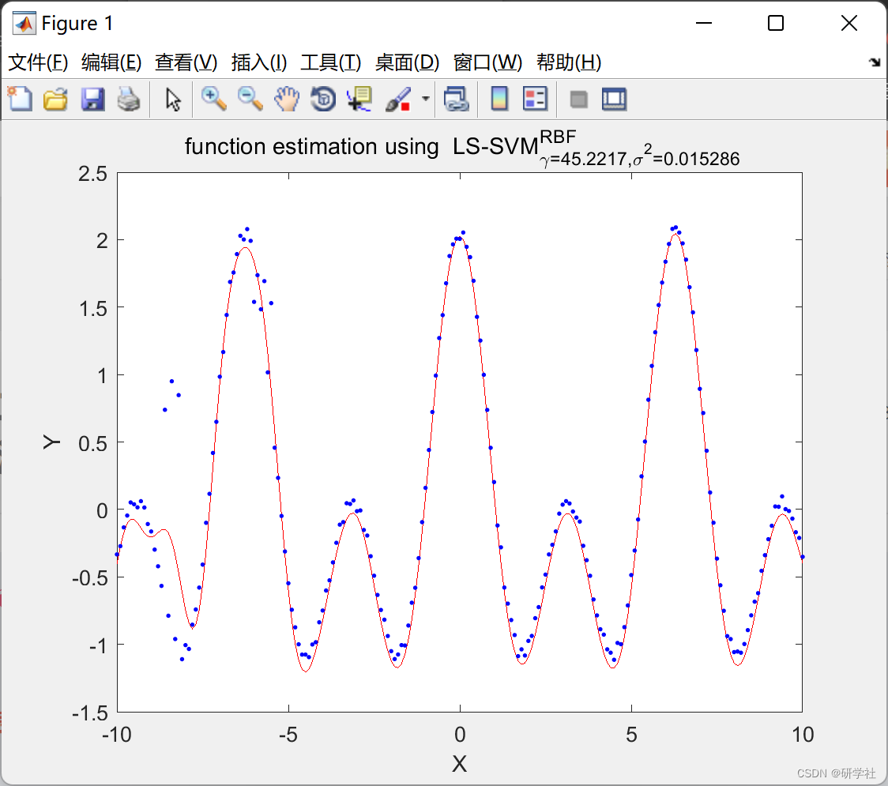
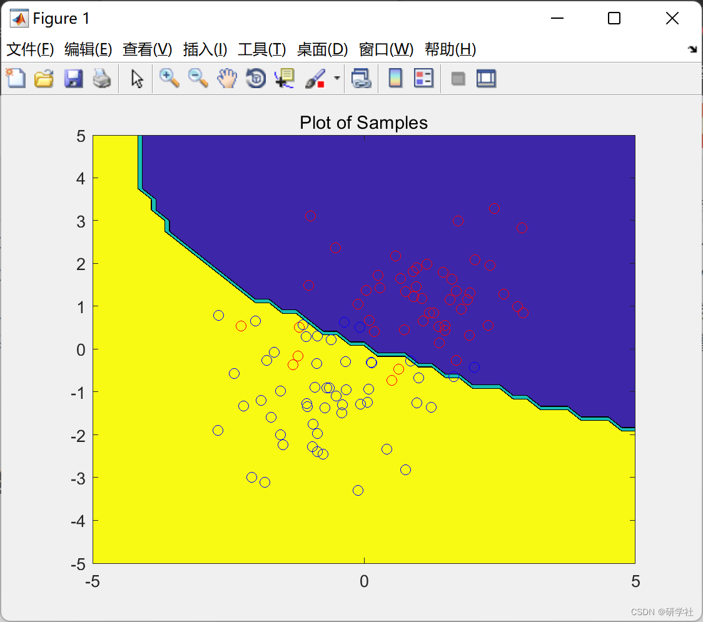
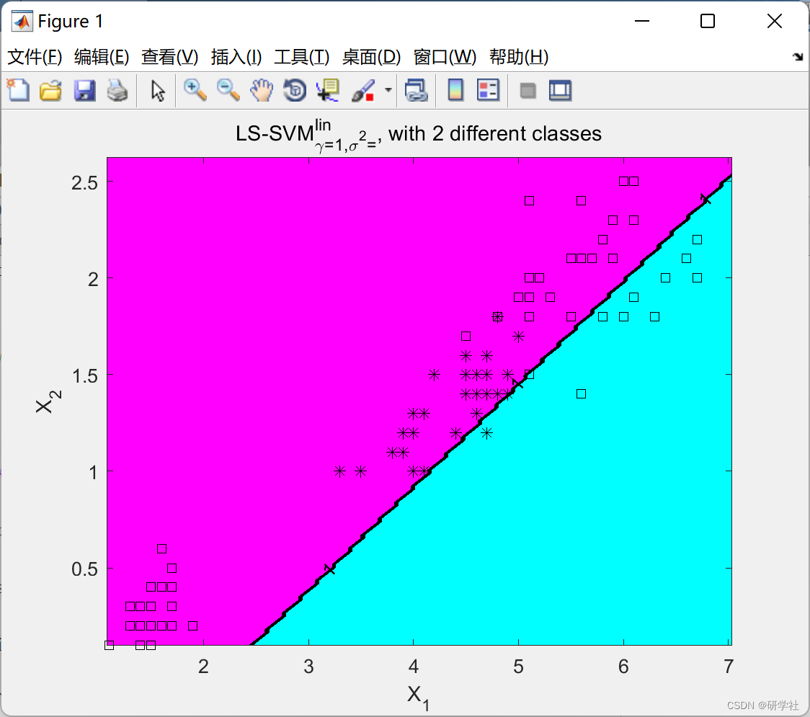
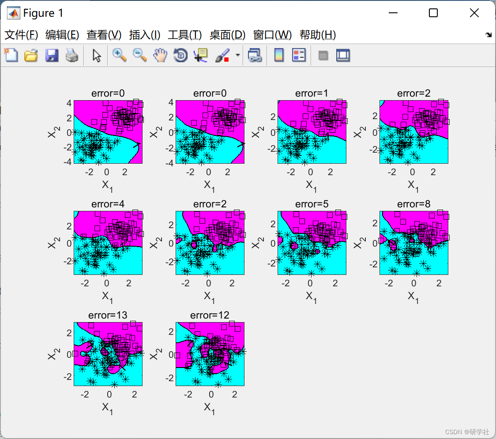
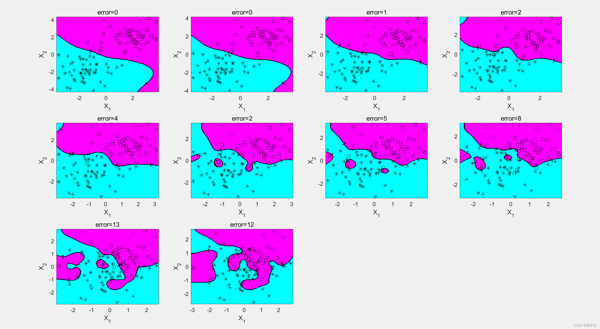
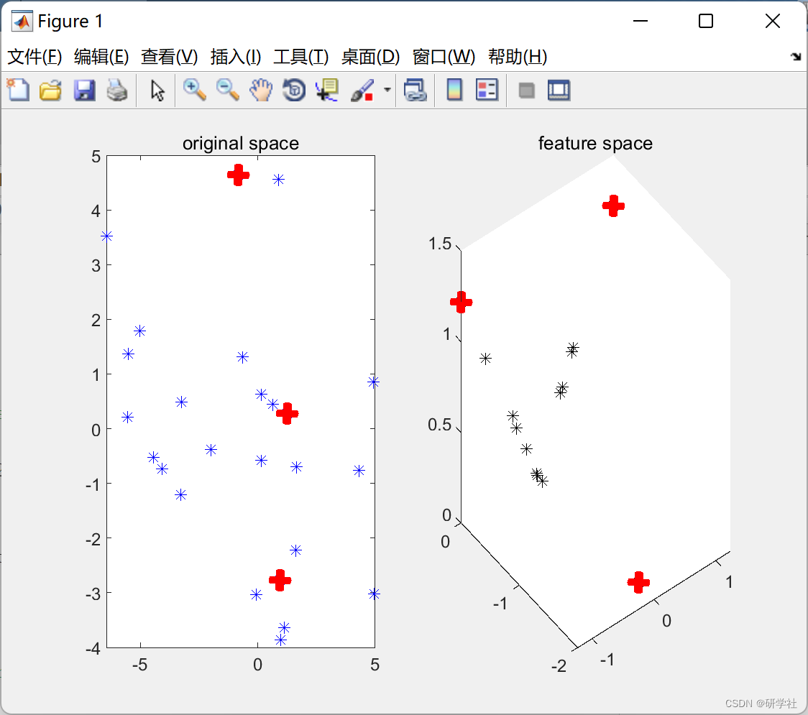
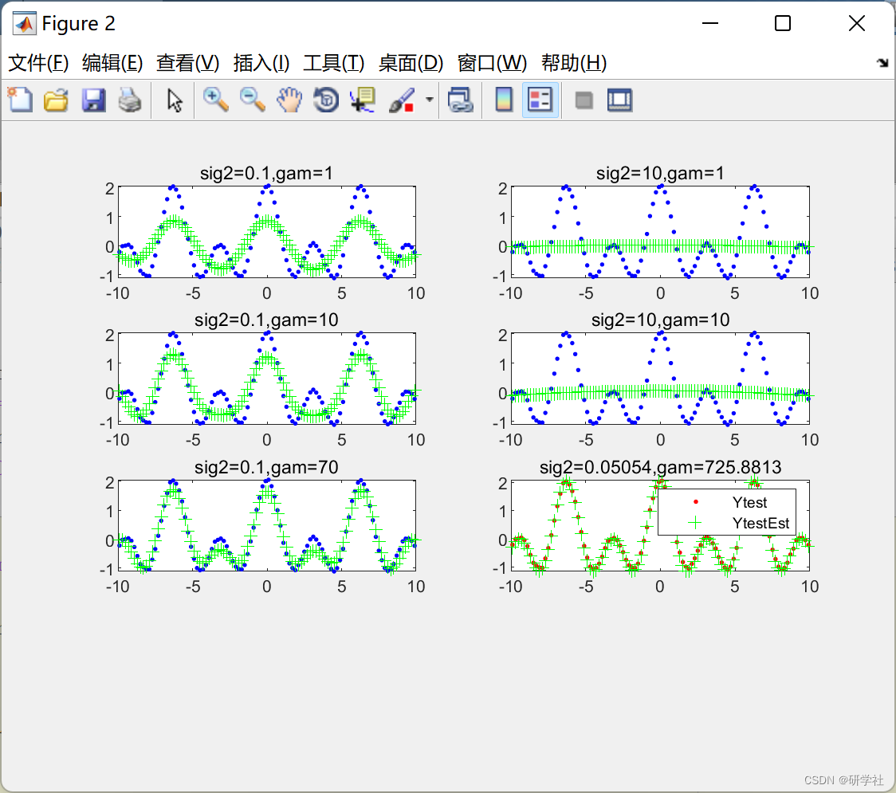

# Classification, function estimation, time series prediction and unsupervised learning based on Least Squares Support Vector Machine (LS-SVM) (Matlab code implementation)

​  
💥💥💞💞 Welcome to this blog❤️❤️💥💥 🏆 Bloggers' Advantages: 🌞🌞🌞 The content of the blog strives for rigorous thinking and clear logic to facilitate readers. ⛳️ Mantra: "Those who travel a hundred miles, are halfway there by ninety." Table of Contents 1 Overview 2 Run Results 3 References 4 MATLAB Code and Read-Along Articles 1 Overview Many problems in mechanics, engineering, and other disciplines can be reduced to integral equations, such as electromagnetic problems and potential problems. In recent years, both theoretically [31.,] and numerically [4), research on integral equations has achieved fruitful results. Regarding numerical solutions, new methods have been continuously introduced, but two drawbacks of these methods (difficulty in determining the number of hidden layers and susceptibility to local minima) hinder their effectiveness in solving first-order integral equations. Least Squares Support Vector Machine (LS-SVM) can effectively overcome these drawbacks and has been successfully applied to solving differential equations and their inverse problems. As a machine learning method, this paper applies LS-SVM for classification, function estimation, time series prediction, and unsupervised learning.
📝2 Running results: Due to the length of the document, only a portion of the running results are presented here.
Editor
Editor
Editor
Editor
Editor
Editor
Part of the code:
randn('state',100)  
X1 = +1 + randn(50,2);  
randn('state',200);  
X2 = -1 + randn(51,2);  
X = [X1; X2];  
Y1 = ones(size(X1,1),1);  
Y2 = -1*ones(size(X2,1),1);  
Y = [Y1; Y2];  
%test data  
x = -5.0:0.25:5.0;  
y = -5.0:0.25:5.0;  
[xt, yt] = meshgrid(x,y);  
grid = [xt(:) yt(:)];  
%bayes classifier  
% pc1 = normpdf2(grid, [-1; -1], [1 0;0 1]);  
% pc2 = normpdf2(grid, [+1; +1], [1 0;0 1]);  
% class = pc1>=pc2;  
%estimate bayes classfier  
mean1 = mean(X1); mean2 = mean(X2);  
cov1 = cov(X1); cov2 = cov(X2);  
pc1 = normpdf2(grid, mean2, cov2);  
pc2 = normpdf2(grid, mean1, cov1);  
class = pc1>=pc2;  
%visualization  
grid = reshape(class,length(x),length(y));  
contourf(x,y,grid,2);hold on;  
hold on  
plot(X1(:,1),X1(:,2),'ro');  
plot(X2(:,1),X2(:,2),'bo');  
title('Plot of Samples');  
%legend([pos neg],'positive data','negative data');  
hold off  
X=(-10:0.1:10)';  
Y = cos(X) + cos(2*X) + 0.1.*rand(length(X),1);  
out=[15 17 19];  
Y(out)=0.7+0.3*rand(size(out));  
out=[41 44 46];  
Y(out)=1.5+0.2*rand(size(out));  
gam=100;sig2=0.1;  
[alpha,b]=trainlssvm({X,Y,'f',gam,sig2,'RBF_kernel'});  
plotlssvm({X,Y,'f',gam,sig2,'RBF_kernel'},{alpha,b});  
%%  
model=initlssvm(X,Y,'f',[],[],'RBF_kernel');  
costFun='rcrossvalidatelssvm';  
wFun='whuber';  
model=tunelssvm(model,'simplex',costFun,{10,'mae'},wFun);  
model=robustlssvm(model);  
plotlssvm(model);  
📃3 References [1] Su Lei, Nabi, Zhang Huiguo, Hu Xijian. Spatio-temporal variable coefficient regression model algorithm based on LS-SVM and simulation [J]. Computer Simulation, 2022, 39(07):342-347.
[1] Cao Xiume, Zhu Meiyue, Wu Zicuk. Approximate Solutions of First-Class Integral Equations Based on LS-SVM [J]. Journal of Qingdao Agricultural University (Natural Science Edition), 2022, 39(03): 222-225.
📋4 Matlab code and detailed article reading

## Images

<!-- PAYMENT_BLOCK -->

## Get this dataset

- Payment link (Stripe): [Buy now](https://buy.stripe.com/3cs8yP7sY87d0vu9AB)
- Payment QR code: 

<!-- /PAYMENT_BLOCK -->
